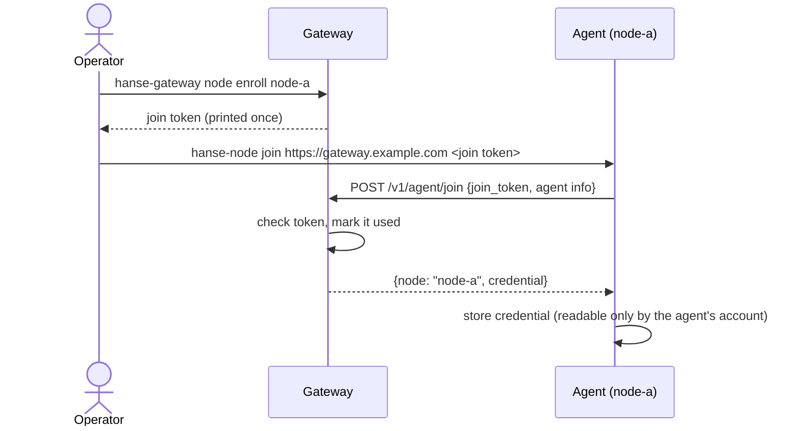
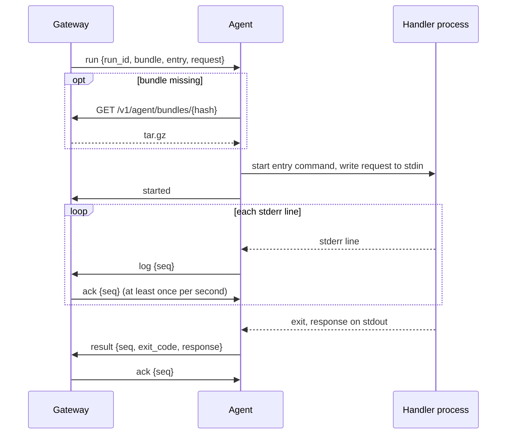
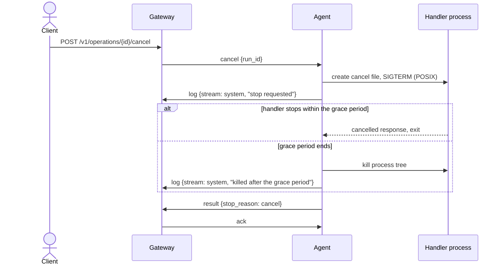
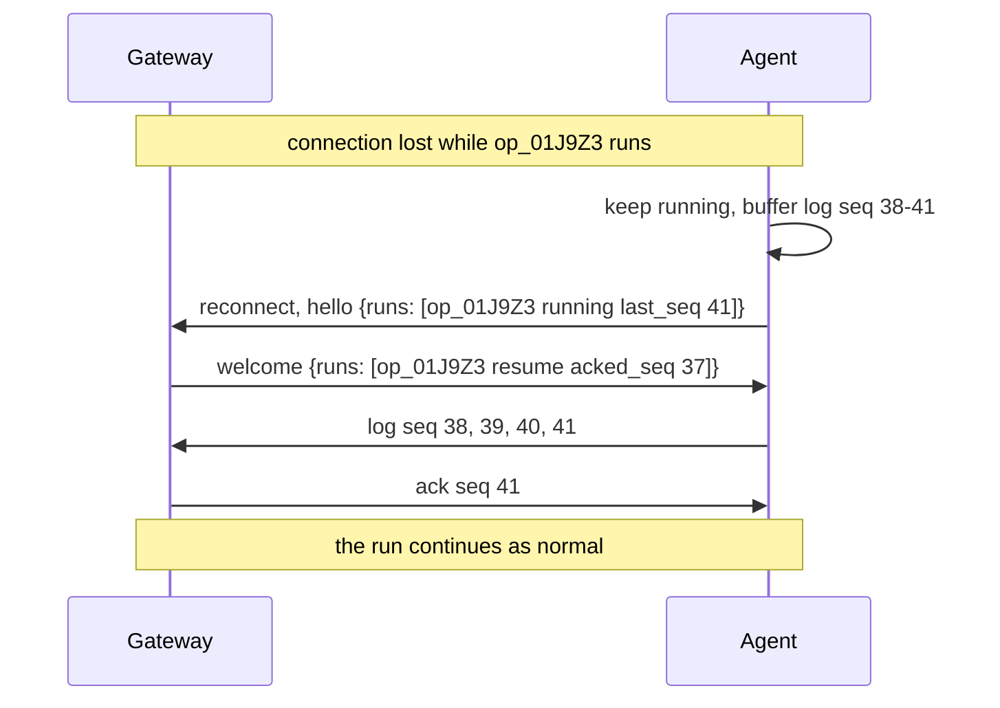

# Hanse agent protocol

Version: `hanse.agent/v1`

This document defines how the Hanse Gateway and the node agent, `hanse-node`, talk to each other. It covers enrollment, the agent connection, handler delivery, running handlers, cancellation, and reconnects.

Read the [architecture document](architecture.md) first, especially [Node agent](architecture.md#8-node-agent). The agent runs handlers as the [handler contract](handler-contract.md) defines. This document defines only how run requests, logs, and results travel between the Gateway and the agent.

The Gateway host runs the agent code inside the Gateway process. That embedded agent does not use this protocol.

The words **must**, **must not**, **should**, and **may** carry their usual specification meaning.

## Contents

1. [Overview](#1-overview)
2. [Enrollment](#2-enrollment)
3. [Connection](#3-connection)
4. [Messages](#4-messages)
5. [Handler delivery](#5-handler-delivery)
6. [Running a handler](#6-running-a-handler)
7. [Cancellation](#7-cancellation)
8. [Disconnects and reconnects](#8-disconnects-and-reconnects)
9. [Privileged runs](#9-privileged-runs)
10. [Errors and close codes](#10-errors-and-close-codes)
11. [Limits](#11-limits)
12. [Versioning and compatibility](#12-versioning-and-compatibility)
13. [JSON Schemas](#13-json-schemas)

## 1. Overview

The agent always starts the conversation. The Gateway never connects to a node.

| Step | Transport | Endpoint |
|---|---|---|
| Enrollment, once per node | HTTPS request | `POST /v1/agent/join` |
| Connection, kept open | WebSocket over HTTPS | `GET /v1/agent/connect` |
| Handler download, when the agent lacks a handler | HTTPS request | `GET /v1/agent/bundles/{hash}` |

The agent must use `https` URLs. It may use `http` only when the Gateway URL's host is a loopback address, such as `127.0.0.1`, for tests.

## 2. Enrollment



### 2.1 Tokens and credentials

| Value | Format | Lifetime |
|---|---|---|
| Join token | `hjt_` followed by 32 random bytes in unpadded base64url | One use. Expires 15 minutes after creation by default. |
| Node credential | `hnc_` followed by 32 random bytes in unpadded base64url | Until revoked with `hanse-gateway node revoke <id>` or replaced by a new enrollment |

The Gateway stores only the SHA-256 hash of each value and compares hashes in constant time. Both values are bound to one node ID when they are created.

Enrolling a node again revokes its previous credential and closes its open connection.

### 2.2 Request

```http
POST /v1/agent/join HTTP/1.1
Content-Type: application/json
```

```json
{
  "protocol": "hanse.agent/v1",
  "join_token": "hjt_<token>",
  "agent_version": "1.0.0",
  "os": "linux",
  "arch": "arm64"
}
```

### 2.3 Response

On success, the Gateway answers `200`:

```json
{
  "node": "node-a",
  "credential": "hnc_<credential>"
}
```

| Status | Error code | Meaning |
|---|---|---|
| `400` | `invalid_request` | The body is malformed, or the protocol version is not supported. |
| `401` | `join_token_invalid` | The token is unknown, used, or expired. All three cases return the same error, so the response reveals nothing about which tokens exist. |
| `409` | `node_mismatch` | The agent's OS or architecture differs from the node's entry in `nodes.yaml`. The token stays unused. |

Error bodies use the Gateway API's usual error format.

## 3. Connection

### 3.1 Opening

```http
GET /v1/agent/connect HTTP/1.1
Connection: Upgrade
Upgrade: websocket
Authorization: Bearer hnc_<credential>
Sec-WebSocket-Protocol: hanse.agent.v1
```

- The Gateway checks the credential before it accepts the upgrade. A missing, wrong, or revoked credential gets `401`, and the agent must not retry until an operator acts. The agent logs the error and retries once an hour.
- The WebSocket subprotocol names the protocol's major version. The Gateway selects the subprotocol it supports. If it supports none of the offered ones, it answers `426 Upgrade Required`.
- After the upgrade, the agent must send a [`hello`](#41-hello) message first. The Gateway answers with [`welcome`](#42-welcome). If either message does not arrive within 10 seconds, the other side closes the connection.

### 3.2 One connection per node

Each node has at most one connection. When a second connection for the same node completes its `hello`, the Gateway closes the older one with the close code `4002`.

### 3.3 Heartbeats

- Each side sends a [`heartbeat`](#410-heartbeat) message when it has sent nothing else for `heartbeat_interval` seconds. The Gateway sets the value in `welcome`. The default is 15 seconds.
- Each side treats the connection as lost when it receives nothing for `heartbeat_timeout` seconds. The default is 45 seconds. It then closes the connection.
- Application messages are used instead of WebSocket ping frames, because some proxies do not pass ping frames through.

### 3.4 Reconnecting

After a lost connection, the agent waits and connects again. The wait starts at 1 second and doubles after each failed attempt, up to 60 seconds. The agent adds a random delay of up to 20% of the wait, so that many agents do not reconnect at the same moment. A successful `welcome` resets the wait.

## 4. Messages

Every message is one JSON object in one WebSocket text frame. The `type` field names the message. Binary frames are not used.

| Message | Direction | Purpose |
|---|---|---|
| `hello` | Agent to Gateway | Introduce the agent and list its unfinished runs |
| `welcome` | Gateway to agent | Accept the agent, set heartbeat timing, and decide what happens to unfinished runs |
| `run` | Gateway to agent | Start a handler |
| `started` | Agent to Gateway | The handler process started |
| `rejected` | Agent to Gateway | The handler did not start |
| `log` | Agent to Gateway | One log line |
| `result` | Agent to Gateway | The handler ended |
| `ack` | Gateway to agent | The Gateway stored messages up to a sequence number |
| `cancel` | Gateway to agent | Stop a handler |
| `heartbeat` | Both | Keep the connection alive |
| `error` | Both | Report a protocol problem |

Timestamps use RFC 3339 format in UTC, with milliseconds.

### 4.1 hello

```json
{
  "type": "hello",
  "protocol": "hanse.agent/v1",
  "agent_version": "1.0.0",
  "os": "linux",
  "arch": "arm64",
  "contracts": ["hanse.handler/v1"],
  "max_concurrent_runs": 16,
  "runs": [
    { "run_id": "op_01J9Z3", "state": "running", "last_seq": 41 }
  ]
}
```

| Field | Meaning |
|---|---|
| `protocol` | The full protocol version. |
| `agent_version` | The agent's release version. |
| `os`, `arch` | The node's OS and architecture, using Go's `GOOS` and `GOARCH` values. |
| `contracts` | The handler contract versions the agent can run. |
| `max_concurrent_runs` | The number of handlers the agent runs at the same time, from `agent.yaml`. |
| `runs` | Every run that the agent has not finished reporting. See [Reconnects](#8-disconnects-and-reconnects). |
| `runs[].state` | `running`, `finished` when the result is waiting for an `ack`, or `lost` when the agent restarted and no longer knows the run's outcome. |
| `runs[].last_seq` | The highest sequence number the agent has produced for the run. `0` for `lost` runs. |

The Gateway closes the connection with `4003` when it does not support the protocol, and with `4004` when the OS or architecture differs from `nodes.yaml`.

### 4.2 welcome

```json
{
  "type": "welcome",
  "node": "node-a",
  "gateway_version": "1.0.0",
  "heartbeat_interval": 15,
  "heartbeat_timeout": 45,
  "runs": [
    { "run_id": "op_01J9Z3", "action": "resume", "acked_seq": 37 }
  ]
}
```

`runs` holds one entry for each run in `hello`. `action` is `resume` or `abandon`. See [Reconnects](#8-disconnects-and-reconnects).

### 4.3 run

```json
{
  "type": "run",
  "run_id": "op_01J9Z3",
  "bundle": "sha256:9f2c4e0b6f1d8a7c3e5b2a1d0c9f8e7d6c5b4a3f2e1d0c9b8a7f6e5d4c3b2a1f",
  "entry": ["bash", "handler.sh"],
  "request": {
    "contract": "hanse.handler/v1",
    "kind": "operation",
    "id": "op_01J9Z3",
    "capability": "demo",
    "operation": "count",
    "arguments": { "to": 3 },
    "nodes": {},
    "executor": {
      "id": "node-a",
      "name": "Home server",
      "os": "linux",
      "arch": "arm64",
      "address": "192.0.2.10",
      "attributes": {}
    },
    "secrets": {},
    "deadline": "2026-10-30T08:15:30.000Z"
  },
  "privileged": false,
  "grace_period_ms": 10000,
  "limits": {
    "response_bytes": 1048576,
    "log_line_bytes": 16384
  }
}
```

| Field | Meaning |
|---|---|
| `run_id` | The ID of this run. It equals `request.id`: an operation ID, or an `opt_` ID for an option provider call. |
| `bundle` | The content hash of the capability's handler files. See [Handler delivery](#5-handler-delivery). |
| `entry` | The entry command for the agent's OS, as an argument list. Relative to the bundle's directory. |
| `request` | The request envelope from the handler contract. The agent writes it to the handler's stdin unchanged. |
| `privileged` | Whether the run needs administrator rights. |
| `elevation` | Present only when `privileged` is `true`. Holds `password`. See [Privileged runs](#9-privileged-runs). |
| `grace_period_ms` | The time between the stop request and the kill. |
| `limits` | The handler contract limits that the agent enforces. |

The agent enforces `request.deadline` itself, so the deadline holds while the agent is disconnected.

A `run` with a `run_id` that the agent already knows is ignored. This makes it safe for the Gateway to send a `run` again after a reconnect.

### 4.4 started

```json
{ "type": "started", "run_id": "op_01J9Z3", "ts": "2026-10-30T08:10:30.120Z" }
```

The agent sends `started` once the handler process exists and its stdin has received the request.

### 4.5 rejected

```json
{
  "type": "rejected",
  "run_id": "op_01J9Z3",
  "code": "elevation_denied",
  "message": "wrong password"
}
```

The handler did not start, and no further messages for this run follow. `code` is one of:

| Code | Meaning |
|---|---|
| `agent_busy` | The agent is already running `max_concurrent_runs` handlers. |
| `bundle_unavailable` | The agent could not download the bundle. |
| `handler_integrity` | The files in the cache do not match the bundle hash, even after a fresh download. |
| `handler_start_failed` | The entry command could not start, for example because the interpreter is missing. |
| `elevation_denied` | The password is wrong, elevation is off or not allowed for this operation in `agent.yaml`, or elevation is locked after wrong passwords. |
| `unsupported_contract` | The agent cannot run the request's handler contract version. |

The `message` must not contain the password or any secret.

### 4.6 log

```json
{
  "type": "log",
  "run_id": "op_01J9Z3",
  "seq": 3,
  "ts": "2026-10-30T08:10:31.004Z",
  "stream": "stderr",
  "line": "count 1 of 3"
}
```

| Field | Meaning |
|---|---|
| `seq` | The run's sequence number. It starts at `1` and grows by one with every `log` and `result` message of the run. |
| `stream` | `stderr` for a handler line. `system` for an agent event, such as "stop requested", "killed after the grace period", or "dropped 120 buffered lines". |
| `line` | The line text, prepared as the handler contract describes. |

The Gateway assigns the operation log's own sequence numbers. The protocol's `seq` serves only delivery and resume.

### 4.7 result

```json
{
  "type": "result",
  "run_id": "op_01J9Z3",
  "seq": 6,
  "ts": "2026-10-30T08:10:33.410Z",
  "exit_code": 0,
  "signal": null,
  "stop_reason": null,
  "response": {
    "contract": "hanse.handler/v1",
    "status": "ok",
    "result": { "counted": 3 }
  },
  "output_error": null,
  "duration_ms": 3290
}
```

| Field | Meaning |
|---|---|
| `seq` | The last sequence number of the run. |
| `exit_code` | The process exit code, or `null` when a signal ended the process. |
| `signal` | The signal name that ended the process, such as `SIGKILL`, or `null`. Always `null` on Windows. |
| `stop_reason` | Why the agent stopped the handler: `cancel`, `deadline`, `output_too_large`, or `abandon`. `null` when the handler ended on its own. |
| `response` | The JSON object that the handler wrote to stdout, unchanged, or `null`. |
| `output_error` | `null` when `response` holds a JSON object. Otherwise `missing` for empty stdout, `invalid` for stdout that is not one JSON object, or `too_large` for stdout over the limit. |
| `duration_ms` | The time from process start to process end. |

The agent does not judge the response. The Gateway validates `response` against the handler contract schema and decides the final state with the contract's [exit code table](handler-contract.md#5-exit-codes-and-final-states).

### 4.8 ack

```json
{ "type": "ack", "run_id": "op_01J9Z3", "seq": 6 }
```

The Gateway has stored every message of the run up to and including `seq`. The agent may then drop those messages from its buffer. The Gateway sends an `ack` at least once per second while a run produces messages, and at once after a `result`. After the `ack` for the `result`, the run is complete, and the agent forgets it.

### 4.9 cancel

```json
{ "type": "cancel", "run_id": "op_01J9Z3" }
```

The agent stops the handler with the [cancellation steps](handler-contract.md#7-cancellation) and then sends the `result` as usual, with `stop_reason` set to `cancel`. A `cancel` for an unknown or finished run is ignored.

### 4.10 heartbeat

```json
{ "type": "heartbeat", "ts": "2026-10-30T08:10:45.000Z" }
```

### 4.11 error

```json
{ "type": "error", "code": "unknown_message", "message": "unknown message type: progress" }
```

`run_id` is present when the error concerns one run. See [Errors and close codes](#10-errors-and-close-codes).

## 5. Handler delivery

### 5.1 Bundles and hashes

A bundle is the content of one capability directory: the manifest and every handler file. The Gateway computes its content hash when it loads the capability:

1. List every regular file in the directory, recursively, with paths relative to the directory and `/` as the separator. A capability directory must not contain symbolic links.
2. Sort the list by path, comparing bytes.
3. For each file, write one line: the path, a NUL byte, `755` if any execute bit is set in the file's permission bits or `644` otherwise, a NUL byte, the lowercase hex SHA-256 of the file content, and `\n`.
4. The bundle hash is `sha256:` followed by the lowercase hex SHA-256 of all lines together.

The same algorithm runs on every OS, and it reads the file permission bits only. A file system that holds no execute bit, such as NTFS on Windows, reports none, so a Windows Gateway counts every file as `644`. A Gateway on Linux or macOS counts an executable file as `755`. The archive of section 5.2 records the mode of every file, so an agent on any OS hashes a bundle the way the Gateway did.

### 5.2 Download

When a `run` names a bundle that the agent does not have, the agent downloads it before it starts the handler:

```http
GET /v1/agent/bundles/sha256:9f2c...2a1f HTTP/1.1
Authorization: Bearer hnc_<credential>
```

The Gateway answers with a gzip-compressed tar archive (`application/gzip`) of the bundle's files. The Gateway serves only bundles of capabilities that the node is an eligible executor for.

The agent:

1. Unpacks the archive into a new temporary directory inside its cache. It rejects absolute paths, paths that contain `..`, links, and device files.
2. Reads the entry mode of every unpacked file from its tar header: `755` when the header mode has any execute bit, `644` otherwise.
3. Computes the bundle hash of the unpacked files from those recorded modes, not from the modes its own file system reports. If the hash differs from the requested hash, the agent deletes the directory and answers `rejected` with `handler_integrity`.
4. Writes the recorded modes as a JSON object, one `755` or `644` value per relative path, to `<cache_dir>/<hex hash>.modes`. The file sits beside the bundle directory, so it is not part of the hash.
5. Renames the directory to `<cache_dir>/<hex hash>`.

The tar header is the record of the bundle hash, so a bundle that the Gateway built on Linux or macOS, with an executable handler, verifies on Windows, where the unpacked files report mode `644`.

The agent downloads each bundle once, even when several runs need it at the same time.

### 5.3 Check before every run

Before each run, the agent computes the hash of the bundle's directory again, from the entry modes it stored beside the directory. When the hash differs, the agent deletes the directory and downloads the bundle again. When the new copy also differs, it answers `rejected` with `handler_integrity`.

A cache entry that has no stored mode list, written by an older agent, is hashed with the modes on disk. On Windows that entry is downloaded again when it holds an executable file.

The agent may delete bundles that no run has used for 7 days.

## 6. Running a handler



The Gateway sets the operation to `running` when it receives `started`. If it receives `rejected`, the operation fails with the code from `rejected`.

The agent may run up to `max_concurrent_runs` handlers at the same time. Messages of different runs can interleave. Messages of one run always arrive in `seq` order.

## 7. Cancellation



The handler contract defines the stop request, the grace period, and the kill on each OS. A deadline follows the same steps, started by the agent itself, with `stop_reason` set to `deadline`.

After it sends the stop request, the Gateway keeps the operation `running` and waits for the agent's result, so the handler decides its own final state: a handler that writes an `ok` response with exit code `0` during the grace period ends `completed` ([handler contract §5](handler-contract.md#5-exit-codes-and-final-states)). The wait ends when the result arrives. It is capped at the grace period plus 5 seconds, because the kill log line and the result cross a reverse proxy and a slow link; a result that arrives later is ignored, and the Gateway stores `cancelled`, or `failed` with `timeout` for a deadline.

If the agent is disconnected when a client cancels, the Gateway marks the operation `cancelled` at once and logs a `system` line that says so. When the agent reconnects, the Gateway answers `abandon` for that run.

## 8. Disconnects and reconnects

### 8.1 While disconnected

- The agent keeps every handler running and enforces its deadline.
- The agent buffers the `log` and `result` messages that the Gateway has not acknowledged. The buffer holds up to 10 MiB for all runs together. When it is full, the agent drops the oldest `log` messages of the run with the most buffered data, and adds one `system` log line that counts the dropped lines. It never drops a `result`.
- The agent keeps a small journal on disk with the ID of every run it accepted. It removes an entry after the `ack` for the run's `result`. After an agent restart, the journal lets the agent report runs whose outcome it lost.
- The Gateway waits for the agent to come back. If the agent does not reconnect within 5 minutes, the Gateway fails each of its running operations with `executor_connection_lost`.

### 8.2 Resuming



The Gateway decides the action for each run in `hello`:

| The Gateway's view of the run | `hello` state | Action | What follows |
|---|---|---|---|
| Still waiting for its result | `running` or `finished` | `resume` | The agent resends every message with a `seq` above `acked_seq`, in order, and then continues. The Gateway ignores any message it already stored, so nothing is duplicated. |
| Already ended: cancelled while the agent was away, or failed after the 5-minute window | any | `abandon` | The agent stops the handler if it still runs, with `stop_reason` `abandon`, and discards the run's buffered messages. It sends nothing more for the run. |
| An option provider call | any | `abandon` | Option calls are not resumed. The client request has already failed. |
| Any | `lost` | `abandon` | The Gateway fails the operation with `executor_connection_lost` and logs that the agent restarted. |

For each run that the Gateway sent but that is missing from `hello`, the agent never accepted it. The Gateway sends that `run` again, unless its operation has already ended.

## 9. Privileged runs

- The `run` message carries `elevation.password` only when `privileged` is `true`. The password exists only in that message, in the agent's memory, and in the private pipe that the agent uses to pass it to `sudo` on POSIX systems.
- The agent checks the password and its local elevation settings before it starts the handler. When the check fails, it answers `rejected` with `elevation_denied`. The [architecture](architecture.md#85-privileged-operations) describes the checks and the lockout.
- Neither side writes the password to a log, a journal, a buffer, or an error message. The agent's journal never stores `run` messages.
- After a reconnect, the Gateway never sends a privileged `run` again unless it still holds the password in memory. If the Gateway has restarted, the operation has already failed with `gateway_restart`.

## 10. Errors and close codes

A side that receives a malformed message, or a message that breaks this protocol, sends an `error` message and closes the connection with `4000`. Exceptions:

- An unknown `type` gets an `error` with `unknown_message`, and the connection stays open. This lets a newer side probe for features.
- Unknown fields in a known message are ignored.

| Close code | Sent by | Meaning | Agent behavior |
|---|---|---|---|
| `1000` | Either | Normal close, such as an agent shutdown | Reconnect with backoff, unless the agent is shutting down |
| `4000` | Either | Protocol error | Reconnect with backoff |
| `4001` | Gateway | The node credential was revoked | Stop reconnecting. Log the reason. Retry once an hour. |
| `4002` | Gateway | A newer connection for the same node replaced this one | Do not reconnect from this process |
| `4003` | Gateway | The protocol version is not supported | Log the reason. Retry once an hour. |
| `4004` | Gateway | The OS or architecture differs from `nodes.yaml` | Log the reason. Retry once an hour. |
| `4005` | Gateway | The node is disabled in `nodes.yaml` | Reconnect with backoff, up to the 60-second wait |

## 11. Limits

| Limit | Value |
|---|---|
| Size of one WebSocket message | 4 MiB. A `run` message carries the request envelope, and a `result` carries a response of up to 1 MiB, so this leaves room. |
| `hello` and `welcome` timeout | 10 seconds |
| Heartbeat interval and timeout | 15 and 45 seconds by default, set by the Gateway in `welcome` |
| Reconnect wait | 1 second, doubling, up to 60 seconds, plus up to 20% random delay |
| Agent buffer while disconnected | 10 MiB by default, set in `agent.yaml` |
| Gateway wait for a reconnect during a run | 5 minutes by default, set in `gateway.yaml` |
| Join token lifetime | 15 minutes by default, set in `gateway.yaml` |

## 12. Versioning and compatibility

The protocol version has two forms: `hanse.agent/v1` in message fields, and `hanse.agent.v1` as the WebSocket subprotocol, because subprotocol names cannot contain `/`.

Within `hanse.agent/v1`, the following changes are allowed. Both sides must keep working when they happen.

- A new optional field in a message.
- A new message type that the other side may ignore. The receiver answers `unknown_message`, and the sender falls back to the older behavior.
- A new value for `rejected.code`, `stop_reason`, or a log line's text.
- New default limits.

Any other change needs a new major version, such as `hanse.agent/v2`, with its own subprotocol name. During an upgrade, the agent offers every major version it supports, newest first, in `Sec-WebSocket-Protocol`. The Gateway selects the newest one it supports.

The Gateway supports the previous major version for at least one Gateway minor release after a new one appears. It logs a deprecation warning for every agent that still uses the previous version. `GET /v1/version` lists the supported versions.

The agent version and the Gateway version are independent. Compatibility depends only on the protocol version and the handler contract versions that `hello` lists.

## 13. JSON Schemas

One schema covers every WebSocket message. It uses JSON Schema draft 2020-12. Messages allow additional properties, so that later `v1` releases can add optional fields.

```json
{
  "$schema": "https://json-schema.org/draft/2020-12/schema",
  "$id": "urn:hanse:agent:v1:message",
  "title": "Hanse agent protocol message, hanse.agent/v1",
  "type": "object",
  "required": ["type"],
  "oneOf": [
    { "$ref": "#/$defs/hello" },
    { "$ref": "#/$defs/welcome" },
    { "$ref": "#/$defs/run" },
    { "$ref": "#/$defs/started" },
    { "$ref": "#/$defs/rejected" },
    { "$ref": "#/$defs/log" },
    { "$ref": "#/$defs/result" },
    { "$ref": "#/$defs/ack" },
    { "$ref": "#/$defs/cancel" },
    { "$ref": "#/$defs/heartbeat" },
    { "$ref": "#/$defs/error" }
  ],
  "$defs": {
    "run_id": { "type": "string", "minLength": 1 },
    "seq": { "type": "integer", "minimum": 1 },
    "ts": { "type": "string", "format": "date-time" },
    "hello": {
      "type": "object",
      "required": ["type", "protocol", "agent_version", "os", "arch", "contracts", "max_concurrent_runs", "runs"],
      "properties": {
        "type": { "const": "hello" },
        "protocol": { "type": "string", "pattern": "^hanse\\.agent/v[0-9]+$" },
        "agent_version": { "type": "string", "minLength": 1 },
        "os": { "type": "string", "minLength": 1 },
        "arch": { "type": "string", "minLength": 1 },
        "contracts": { "type": "array", "items": { "type": "string" }, "minItems": 1 },
        "max_concurrent_runs": { "type": "integer", "minimum": 1 },
        "runs": {
          "type": "array",
          "items": {
            "type": "object",
            "required": ["run_id", "state", "last_seq"],
            "properties": {
              "run_id": { "$ref": "#/$defs/run_id" },
              "state": { "enum": ["running", "finished", "lost"] },
              "last_seq": { "type": "integer", "minimum": 0 }
            }
          }
        }
      }
    },
    "welcome": {
      "type": "object",
      "required": ["type", "node", "gateway_version", "heartbeat_interval", "heartbeat_timeout", "runs"],
      "properties": {
        "type": { "const": "welcome" },
        "node": { "type": "string", "minLength": 1 },
        "gateway_version": { "type": "string", "minLength": 1 },
        "heartbeat_interval": { "type": "integer", "minimum": 1 },
        "heartbeat_timeout": { "type": "integer", "minimum": 1 },
        "runs": {
          "type": "array",
          "items": {
            "type": "object",
            "required": ["run_id", "action"],
            "properties": {
              "run_id": { "$ref": "#/$defs/run_id" },
              "action": { "enum": ["resume", "abandon"] },
              "acked_seq": { "type": "integer", "minimum": 0 }
            },
            "if": { "properties": { "action": { "const": "resume" } } },
            "then": { "required": ["acked_seq"] }
          }
        }
      }
    },
    "run": {
      "type": "object",
      "required": ["type", "run_id", "bundle", "entry", "request", "privileged", "grace_period_ms", "limits"],
      "properties": {
        "type": { "const": "run" },
        "run_id": { "$ref": "#/$defs/run_id" },
        "bundle": { "type": "string", "pattern": "^sha256:[0-9a-f]{64}$" },
        "entry": { "type": "array", "items": { "type": "string" }, "minItems": 1 },
        "request": { "type": "object" },
        "privileged": { "type": "boolean" },
        "elevation": {
          "type": "object",
          "required": ["password"],
          "properties": { "password": { "type": "string" } }
        },
        "grace_period_ms": { "type": "integer", "minimum": 0 },
        "limits": {
          "type": "object",
          "required": ["response_bytes", "log_line_bytes"],
          "properties": {
            "response_bytes": { "type": "integer", "minimum": 1 },
            "log_line_bytes": { "type": "integer", "minimum": 1 }
          }
        }
      },
      "if": { "properties": { "privileged": { "const": true } } },
      "then": { "required": ["elevation"] },
      "else": { "not": { "required": ["elevation"] } }
    },
    "started": {
      "type": "object",
      "required": ["type", "run_id", "ts"],
      "properties": {
        "type": { "const": "started" },
        "run_id": { "$ref": "#/$defs/run_id" },
        "ts": { "$ref": "#/$defs/ts" }
      }
    },
    "rejected": {
      "type": "object",
      "required": ["type", "run_id", "code", "message"],
      "properties": {
        "type": { "const": "rejected" },
        "run_id": { "$ref": "#/$defs/run_id" },
        "code": { "type": "string", "pattern": "^[a-z][a-z0-9_]*$" },
        "message": { "type": "string" }
      }
    },
    "log": {
      "type": "object",
      "required": ["type", "run_id", "seq", "ts", "stream", "line"],
      "properties": {
        "type": { "const": "log" },
        "run_id": { "$ref": "#/$defs/run_id" },
        "seq": { "$ref": "#/$defs/seq" },
        "ts": { "$ref": "#/$defs/ts" },
        "stream": { "enum": ["stderr", "system"] },
        "line": { "type": "string" }
      }
    },
    "result": {
      "type": "object",
      "required": ["type", "run_id", "seq", "ts", "exit_code", "signal", "stop_reason", "response", "output_error", "duration_ms"],
      "properties": {
        "type": { "const": "result" },
        "run_id": { "$ref": "#/$defs/run_id" },
        "seq": { "$ref": "#/$defs/seq" },
        "ts": { "$ref": "#/$defs/ts" },
        "exit_code": { "type": ["integer", "null"] },
        "signal": { "type": ["string", "null"] },
        "stop_reason": { "enum": [null, "cancel", "deadline", "output_too_large", "abandon"] },
        "response": { "type": ["object", "null"] },
        "output_error": { "enum": [null, "missing", "invalid", "too_large"] },
        "duration_ms": { "type": "integer", "minimum": 0 }
      }
    },
    "ack": {
      "type": "object",
      "required": ["type", "run_id", "seq"],
      "properties": {
        "type": { "const": "ack" },
        "run_id": { "$ref": "#/$defs/run_id" },
        "seq": { "$ref": "#/$defs/seq" }
      }
    },
    "cancel": {
      "type": "object",
      "required": ["type", "run_id"],
      "properties": {
        "type": { "const": "cancel" },
        "run_id": { "$ref": "#/$defs/run_id" }
      }
    },
    "heartbeat": {
      "type": "object",
      "required": ["type", "ts"],
      "properties": {
        "type": { "const": "heartbeat" },
        "ts": { "$ref": "#/$defs/ts" }
      }
    },
    "error": {
      "type": "object",
      "required": ["type", "code", "message"],
      "properties": {
        "type": { "const": "error" },
        "code": { "type": "string", "pattern": "^[a-z][a-z0-9_]*$" },
        "message": { "type": "string" },
        "run_id": { "$ref": "#/$defs/run_id" }
      }
    }
  }
}
```

The enrollment request and response bodies:

```json
{
  "$schema": "https://json-schema.org/draft/2020-12/schema",
  "$id": "urn:hanse:agent:v1:join",
  "title": "Hanse agent join request and response, hanse.agent/v1",
  "$defs": {
    "request": {
      "type": "object",
      "required": ["protocol", "join_token", "agent_version", "os", "arch"],
      "properties": {
        "protocol": { "type": "string", "pattern": "^hanse\\.agent/v[0-9]+$" },
        "join_token": { "type": "string", "pattern": "^hjt_[A-Za-z0-9_-]{43}$" },
        "agent_version": { "type": "string", "minLength": 1 },
        "os": { "type": "string", "minLength": 1 },
        "arch": { "type": "string", "minLength": 1 }
      }
    },
    "response": {
      "type": "object",
      "required": ["node", "credential"],
      "properties": {
        "node": { "type": "string", "minLength": 1 },
        "credential": { "type": "string", "pattern": "^hnc_[A-Za-z0-9_-]{43}$" }
      }
    }
  }
}
```
